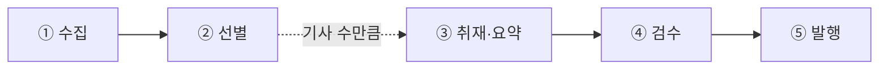

# AI 뉴스레터 에이전트

매일 아침 AI 소식 가운데 **개발팀이 알아야 할 5건**을 골라 Discord로 보내는 LangGraph 에이전트예요.
GitHub Actions가 매일 07:30(KST)에 실행하고, OpenAI 없이 **무료로** 돌아가요.

```
🗞️ 2026-10-29 · AI 브리핑
오늘은 5건을 골랐습니다. (전자신문, The Verge, AI타임스)
1. Google launches Gemini 4 Carbon with a 'significant leap' …   — The Verge
2. [2026 K-오픈소스 AX] 쿤텍 "오픈소스, 반입·관리 체계 갖춰야"     — 전자신문
…
```

## 어떻게 동작하나요

노드 다섯 개가 일을 나눠 맡아요. 그림은 [WORKFLOW.md](WORKFLOW.md)에서 볼 수 있어요.



| 노드 | 하는 일 |
|---|---|
| ① `collect` | RSS·Atom 피드 10곳과 Hacker News API에서 최근 24시간 기사를 모아요 (하루 약 120~130건) |
| ② `select` | 40건씩 묶어 예선 8건, 본선에서 5건을 골라요. 개발팀 키워드(API·가격·오픈소스·개발 도구 등)로 점수를 매기고, 한 매체는 최대 2건 |
| ③ `report` | 고른 기사 수만큼 펼쳐(`Send`) 원문 본문이 600자 이상인지 확인하고, 피드 요약으로 초안을 만들어요 |
| ④ `verify` | 요약이 비었거나 링크가 잘못된 초안을 걸러 `verified`에 담아요 |
| ⑤ `publish` | Discord embed 카드로 보내요. `DRY_RUN=0`일 때만 실제로 보내고, 그 밖에는(기본값) 미리보기만 해요. 보내다 실패하면 실행이 실패로 끝나요 |

### 수집 소스

- 1차 소스(직접 발표): OpenAI, Google DeepMind, Google AI, Hugging Face, AWS ML 블로그
- 2차 소스(매체): TechCrunch, The Verge, MIT Technology Review, AI타임스, 전자신문(AI·SW)
- 공개 API: Hacker News (Algolia 검색 API)

제목·요약·원문 링크만 사용하고, 기사 본문은 다시 배포하지 않아요.

## 파일 구조

```
graph.py                    State · 노드 다섯 개 · build() · run()
run.py                      graph.py를 한 번 실행 (GitHub Actions 진입점)
requirements.txt            Actions에서 설치할 라이브러리
.github/workflows/daily.yml 매일 22:30 UTC(= 07:30 KST) 실행 + 손으로 실행
scripts/trace_run.py        한 번 돌려 노드 순서와 칸별 결과를 logs/run-*.md 로 남김
practice/                   강의 장별 실습 (*_openai.py 는 유료 원본, *_free.py 는 무료판)
```

## 직접 돌려 보기

```bash
uv sync                          # 또는 pip install -r requirements.txt
uv run python run.py --dry-run   # 보내지 않고 로그만
uv run python scripts/trace_run.py
```

Discord로 실제로 보내려면 `DISCORD_WEBHOOK_URL`과 `DRY_RUN=0`이 필요해요.
웹훅 주소는 비밀번호처럼 다루고, 코드나 커밋에 넣지 않아요 (`.env`는 `.gitignore`에 있어요).

## 매일 자동 실행 (GitHub Actions)

1. 레포 **Settings → Secrets and variables → Actions**에 `DISCORD_WEBHOOK_URL`을 등록해요.
2. `daily.yml`이 매일 22:30 UTC에 `python run.py`를 실행해요. GitHub 예약 실행은 몇 분~몇 시간 늦게 시작할 수 있어요.
3. **Actions → 매일 브리핑 → Run workflow**로 손으로도 돌릴 수 있어요. "발행하지 않고 로그만 남기기"를 체크하면 dry-run이에요.

## 무료 버전의 한계

- 선별은 키워드 점수라 맥락을 보지 못해요. 같은 사건이 두 칸을 차지하거나 엉뚱한 기사가 뽑힐 수 있어요.
- 요약은 매체가 피드에 준 첫 문단 그대로예요. 영어 기사는 영어로 나가요.
- LLM 버전으로 바꾸려면 `graph.py`의 `ask_picks`, `draft`, `check` 세 함수만 `practice/ch20·25·30_*_openai.py`의 코드로 갈아 끼우면 돼요 (OpenAI 요금 발생).
