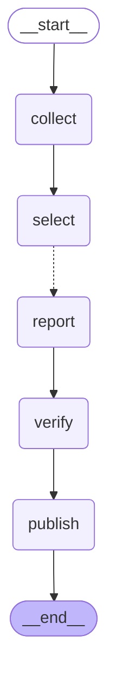

# 뉴스레터 워크플로

`scripts/trace_run.py` 가 skeleton.py 의 그래프에서 자동으로 만든 그림이에요. 점선(`-.->`)은 기사 수만큼 펼쳐지는 엣지(Send)예요.

| 노드 | 하는 일 |
|---|---|
| `collect` | ① 수집 — RSS·Atom 10곳 + Hacker News API에서 24시간 안 기사를 모은다 |
| `select` | ② 선별 — 40건씩 예선 8건, 본선 5건 (무료 키워드 점수) |
| `report` | ③ 취재·요약 — 고른 기사 수만큼 펼쳐 본문 600자 관문을 보고 초안을 만든다 |
| `verify` | ④ 검수 — 형식이 틀린 초안을 버리고 통과한 것만 verified 칸에 담는다 |
| `publish` | ⑤ 발행 — verified 칸을 Discord로 보낸다 (아직 빈 노드) |
